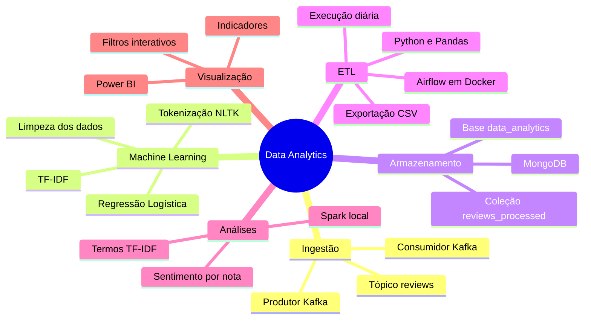
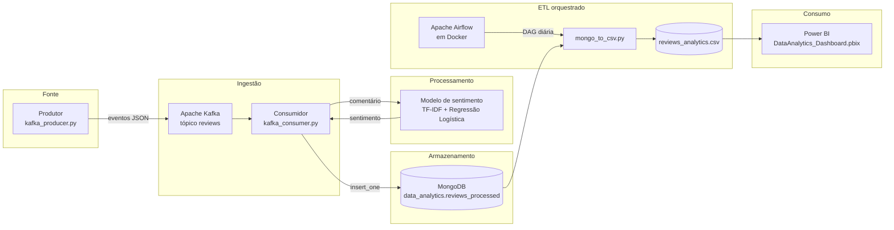
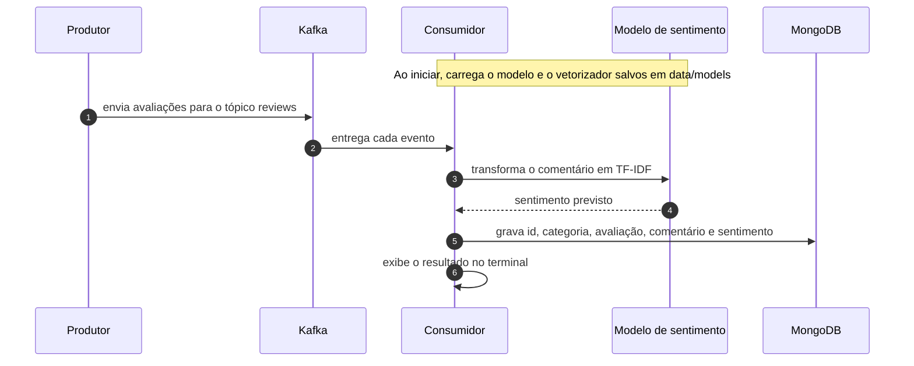
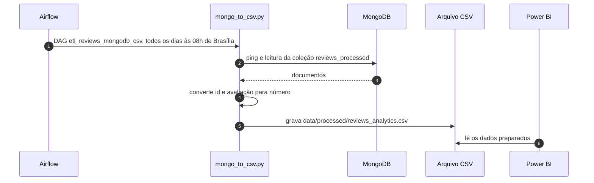
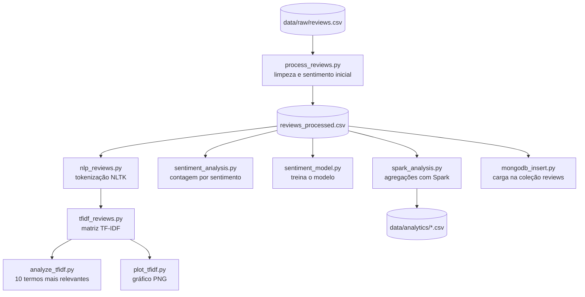
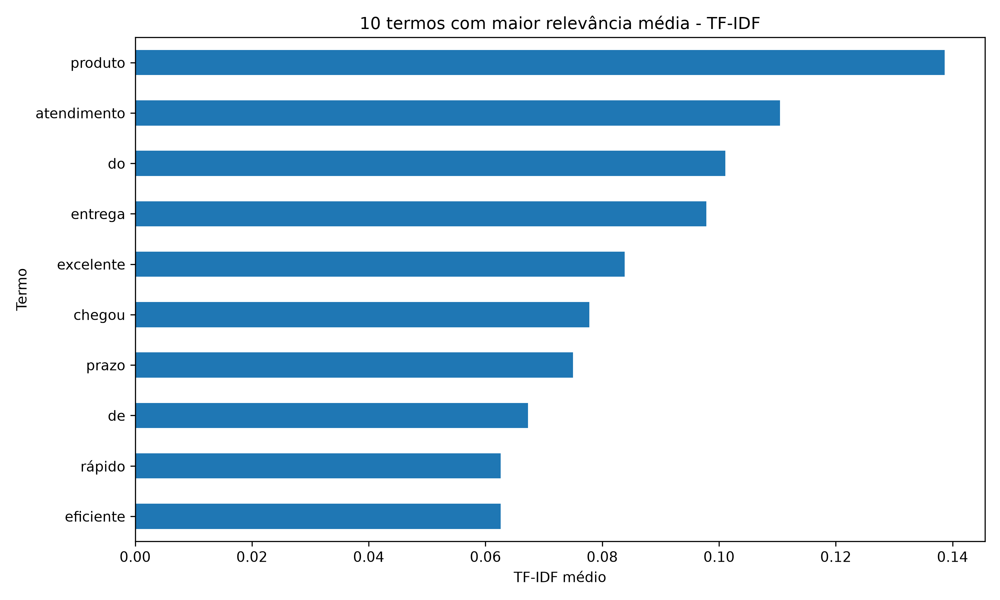
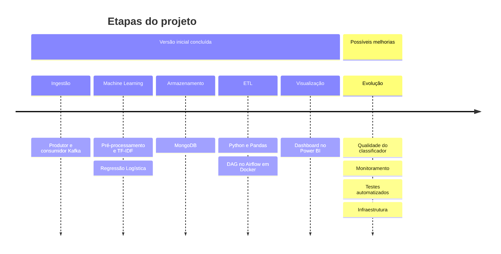

# Data Analytics | Engenharia de Dados, Big Data e Machine Learning

<p align="center">
  
  
  
  
  
  
</p>
<p align="center">
  
  
  
  
  
  
  
</p>
<p align="center">
  
  
  
  
  
</p>

<p align="center">
  Pipeline de dados para processamento de avaliações de produtos, classificação de sentimentos,
  armazenamento de informações e construção de indicadores analíticos.
</p>

<p align="center">
  <a href="#-visão-geral">Visão Geral</a> •
  <a href="#-mapa-do-projeto">Mapa</a> •
  <a href="#-arquitetura-do-pipeline">Arquitetura</a> •
  <a href="#-etapas-de-processamento">Etapas</a> •
  <a href="#-dashboard-analítico">Dashboard</a> •
  <a href="#-como-executar">Como executar</a> •
  <a href="#-tecnologias-e-ferramentas">Tecnologias</a> •
  <a href="#-roteiro">Roteiro</a>
</p>

---

## 📌 Visão Geral

O **Data Analytics** é um projeto de Engenharia de Dados e Ciência de Dados que integra diferentes etapas
de um fluxo analítico, desde a geração e o processamento de informações até a disponibilização de
indicadores em um dashboard.

O projeto utiliza **avaliações de produtos** como fonte de dados para demonstrar a integração entre
mensageria, processamento em Python, armazenamento NoSQL, orquestração de tarefas e Business Intelligence.

A solução combina processamento de dados e Machine Learning para transformar avaliações textuais em
informações estruturadas que podem ser exploradas por meio de indicadores e filtros.

<details>
<summary><b>🧩 Problema abordado</b> (clique para expandir)</summary>

Avaliações de clientes contêm informações **estruturadas**, como notas e categorias, e informações
**textuais**, como comentários. O projeto reúne essas informações em um fluxo de processamento para
facilitar a análise de sentimentos e o acompanhamento de indicadores.

Cada avaliação tem o formato:

| Campo | Exemplo |
|---|---|
| `id` | `1` |
| `cliente` | `Cliente_001` |
| `data` | `2026-09-01` |
| `avaliacao` | `5` (nota de 1 a 5) |
| `comentario` | `Atendimento excelente e produto chegou antes do prazo` |
| `categoria` | `produto`, `entrega` ou `atendimento` |

</details>

### 🎯 Objetivos

- Estruturar um pipeline de processamento de dados.
- Demonstrar a transmissão de mensagens com **Apache Kafka**.
- Aplicar técnicas de **Processamento de Linguagem Natural** à análise de sentimentos.
- Armazenar os dados processados no **MongoDB**.
- Automatizar a execução do fluxo ETL com **Apache Airflow**.
- Preparar conjuntos de dados para análise e visualização.
- Desenvolver um dashboard analítico no **Power BI**.

## 🧠 Mapa do projeto



## 🧱 Arquitetura do Pipeline

O fluxo integra componentes de mensageria, processamento, armazenamento, transformação e visualização.



> [!NOTE]
> **Apache Airflow** orquestra o processo ETL e o **Docker** executa o ambiente de orquestração.

<details>
<summary><b>🔁 Sequência: produtor → Kafka → consumidor → MongoDB</b></summary>



</details>

<details>
<summary><b>🔁 Sequência: execução agendada do ETL</b></summary>



</details>

## 🔧 Etapas de Processamento

| # | Etapa | Descrição |
|---|---|---|
| 1 | **Geração e transmissão** | O produtor gera mensagens de avaliações e usa o Apache Kafka para transmiti-las ao consumidor. |
| 2 | **Processamento e sentimentos** | Os textos são processados para identificar o sentimento associado a cada avaliação. |
| 3 | **Armazenamento NoSQL** | O MongoDB armazena os documentos processados e os disponibiliza para extração posterior. |
| 4 | **Extração, transformação e carga** | Um ETL em Python extrai os documentos, organiza os campos relevantes e exporta um CSV; o Airflow orquestra a execução e o Docker configura o ambiente. |
| 5 | **Visualização e análise** | O Power BI usa os dados preparados para construir indicadores e filtros analíticos. |

<details>
<summary><b>🤖 Abordagem de Machine Learning</b></summary>

- **Pré-processamento** das avaliações (remoção de duplicatas, comentários vazios, notas inválidas).
- **TF-IDF** para representação numérica do texto.
- **Regressão Logística** para classificação.
- Geração de **resultados estruturados** para as etapas seguintes.

O rótulo usado no treinamento vem da nota da avaliação:

| Nota | Sentimento |
|---|---|
| 4 ou 5 | positivo |
| 3 | neutro |
| 1 ou 2 | negativo |

O treinamento (`sentiment_model.py`) separa 30 % dos dados para teste, exibe a acurácia e o relatório de
classificação e salva o modelo e o vetorizador em `data/models/`.

</details>

<details>
<summary><b>🔬 Análises complementares</b></summary>

Scripts que exploram os dados em lote, a partir de `data/raw/reviews.csv`:



| Script | Saída |
|---|---|
| `process_reviews.py` | `data/processed/reviews_processed.csv` |
| `nlp_reviews.py` | `data/processed/reviews_nlp.csv` |
| `tfidf_reviews.py` | `data/processed/reviews_tfidf.csv` |
| `analyze_tfidf.py` | 10 termos com maior TF-IDF médio (terminal) |
| `plot_tfidf.py` | `data/processed/tfidf_top_terms.png` |
| `sentiment_analysis.py` | `data/processed/sentiment_analysis.csv` |
| `spark_analysis.py` | `data/analytics/sentimento.csv`, `categorias.csv`, `avaliacao_categoria.csv` |
| `mongodb_insert.py` | Documentos na coleção `reviews` do MongoDB |

<p align="center">
  
</p>

</details>

## 📊 Dashboard Analítico

O arquivo [`DataAnalytics_Dashboard.pbix`](DataAnalytics_Dashboard.pbix) contém o dashboard desenvolvido
para exploração dos resultados. Ele permite explorar a distribuição das avaliações e comparar os resultados
entre diferentes categorias de produtos.

| Indicador | Tipo |
|---|---|
| Total de avaliações | 🔢 Cartão |
| Nota média | 🔢 Cartão |
| Percentuais e distribuição dos sentimentos classificados | 📈 Distribuição |
| Quantidade de avaliações por categoria | 📊 Comparação |
| Nota média por categoria | 📊 Comparação |
| Filtros por categoria, nota e sentimento | 🎛️ Interativo |

## 🚀 Como executar

> [!IMPORTANT]
> O repositório **não inclui** um `requirements.txt` na raiz nem a configuração do broker Kafka. Os
> scripts esperam **Kafka em `localhost:9092`** e **MongoDB em `localhost:27017`** já em execução.

<details>
<summary><b>📦 Bibliotecas usadas pelos scripts</b></summary>

`pandas`, `scikit-learn`, `joblib`, `pymongo`, cliente Kafka para Python (`kafka`), `nltk`, `matplotlib`
e `pyspark` (requer Java). O contêiner do Airflow instala apenas `pandas` e `pymongo`
([`airflow/requirements.txt`](airflow/requirements.txt)).

</details>

**1. Preparar os dados e treinar o modelo**

```powershell
python src\process_reviews.py
python src\sentiment_model.py
```

**2. Transmitir e classificar as avaliações** (dois terminais)

```powershell
# Terminal 1 — consumidor: classifica e grava no MongoDB
python src\kafka_consumer.py

# Terminal 2 — produtor: envia as avaliações de teste
python src\kafka_producer.py
```

**3. Executar o ETL com Airflow** — na pasta `airflow`:

```powershell
docker compose up -d
```

A interface do Airflow fica disponível em **http://localhost:8080**. A DAG `etl_reviews_mongodb_csv`
executa `src/mongo_to_csv.py`, que gera o CSV usado pelo Power BI.

| DAG | Agendamento | Função |
|---|---|---|
| `etl_reviews_mongodb_csv` | Diário, às 08h de Brasília (`0 11 * * *` em UTC) | Extrai do MongoDB e gera `data/processed/reviews_analytics.csv` |
| `primeira_dag_big_data` | Manual | Fluxo de teste do ambiente Airflow |

Para encerrar o ambiente:

```powershell
docker compose down
```

> [!NOTE]
> O comando acima **não remove** o volume persistente do Airflow.

**4. Abrir o dashboard** — abra `DataAnalytics_Dashboard.pbix` no Power BI Desktop.

<details>
<summary><b>🔐 Configuração e segurança</b></summary>

- O endereço do MongoDB é configurado pela variável **`MONGODB_URI`**.
- O script Python usa `mongodb://localhost:27017/` como padrão local; o Docker Compose usa
  `mongodb://host.docker.internal:27017/` para acessar o MongoDB executado no Windows. O serviço MongoDB
  precisa estar acessível pelo contêiner.
- Credenciais, tokens e arquivos de ambiente com segredos **não devem ser versionados**.
- Modelos treinados e arquivos temporários devem permanecer fora do controle de versão quando não forem
  necessários para a reprodução do projeto (`data/models/` está no `.gitignore`).

</details>

## 🧰 Tecnologias e Ferramentas

| Tecnologia | Aplicação no projeto |
|---|---|
| Python | Geração, processamento e transformação dos dados. |
| Apache Kafka (4.3.1, KRaft) | Transmissão de mensagens entre produtor e consumidor. |
| Scikit-learn | Implementação do classificador de sentimentos. |
| TF-IDF | Representação vetorial dos textos. |
| Regressão Logística | Classificação de sentimentos. |
| NLTK | Tokenização dos comentários em português. |
| MongoDB + PyMongo | Armazenamento dos documentos processados. |
| Pandas | Manipulação e exportação de dados tabulares. |
| Apache Spark (PySpark) | Agregações por sentimento e por categoria em modo local. |
| Matplotlib | Gráfico dos termos mais relevantes do TF-IDF. |
| Apache Airflow (3.3.1) | Orquestração do processo ETL. |
| Docker Compose | Execução do ambiente do Airflow. |
| Power BI | Construção do dashboard e dos indicadores. |
| CSV | Intercâmbio de dados entre o ETL e a ferramenta de visualização. |
| Git e GitHub | Versionamento e documentação do projeto. |

## 📁 Estrutura do Repositório

```text
DataAnalytics/
├── airflow/
│   ├── dags/                       # DAGs: ETL diário e DAG de teste
│   ├── Dockerfile                  # imagem apache/airflow:3.3.1 + pandas e pymongo
│   ├── requirements.txt
│   └── docker-compose.yaml         # Airflow standalone na porta 8080
├── data/
│   ├── raw/reviews.csv             # avaliações de origem
│   ├── processed/                  # dados tratados, TF-IDF e reviews_analytics.csv
│   ├── analytics/                  # agregações geradas com Spark
│   └── models/                     # modelo treinado — gerado localmente, NÃO versionado
├── docs/
│   ├── architecture.md             # arquitetura, execução do ETL e segurança
│   └── project_overview.md         # objetivo, solução e situação do projeto
├── src/
│   ├── kafka_producer.py           # envia avaliações ao Kafka
│   ├── kafka_consumer.py           # classifica e grava no MongoDB
│   ├── sentiment_model.py          # treina TF-IDF + Regressão Logística
│   ├── mongo_to_csv.py             # ETL MongoDB → CSV
│   └── ...                         # limpeza, NLP, TF-IDF, Spark e carga
├── DataAnalytics_Dashboard.pbix    # dashboard do Power BI
└── README.md
```

Documentação complementar: [Arquitetura](docs/architecture.md) • [Visão geral do projeto](docs/project_overview.md)

## 🏅 Competências Demonstradas

| Área | Competências |
|---|---|
| 🛠️ Engenharia de Dados | Integração de componentes; processamento de dados e pipelines ETL |
| 📡 Streaming | Mensageria e processamento de eventos |
| 🗄️ Armazenamento | Bancos de dados NoSQL |
| 🤖 Ciência de Dados | Processamento de Linguagem Natural; Machine Learning aplicado à classificação de textos |
| ⏱️ Operação | Orquestração de tarefas; containerização de ambientes |
| 📊 Business Intelligence | Visualização de indicadores |

## 🧭 Roteiro



A implementação local dos principais componentes está **concluída em sua versão inicial**. A DAG
`etl_reviews_mongodb_csv` foi executada com sucesso no ambiente local, gerando o CSV usado pelo dashboard.

- [x] Ingestão de dados com Apache Kafka
- [x] Processamento de comentários com NLP e Machine Learning
- [x] Persistência em MongoDB
- [x] Transformação e exportação com Python e Pandas
- [x] Orquestração do ETL com Apache Airflow
- [x] Visualização de indicadores no Power BI
- [ ] Aprimorar a qualidade do classificador
- [ ] Monitoramento
- [ ] Testes automatizados
- [ ] Evolução da infraestrutura

> [!WARNING]
> A qualidade das classificações depende do modelo treinado e dos dados utilizados. Antes de aplicações
> reais, recomenda-se validar o desempenho do classificador, a integridade dos dados e o tratamento de falhas.

---

<p align="center">
  <b>Projeto de integração entre Engenharia de Dados, Machine Learning e Business Intelligence, com foco na
  transformação de avaliações textuais em informações estruturadas para análise.</b>
</p>
